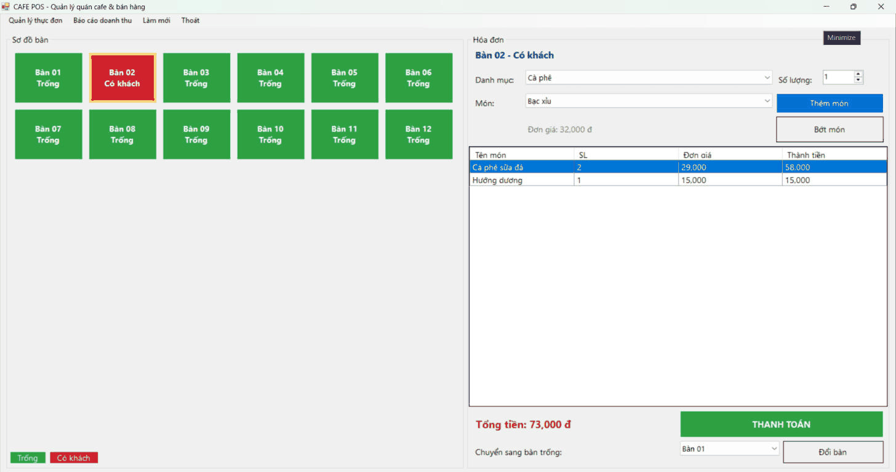
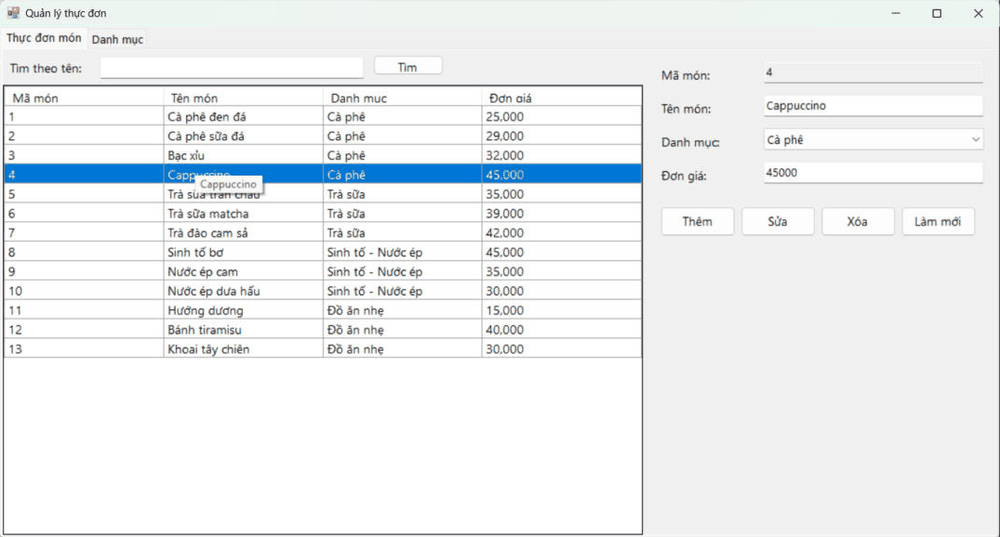
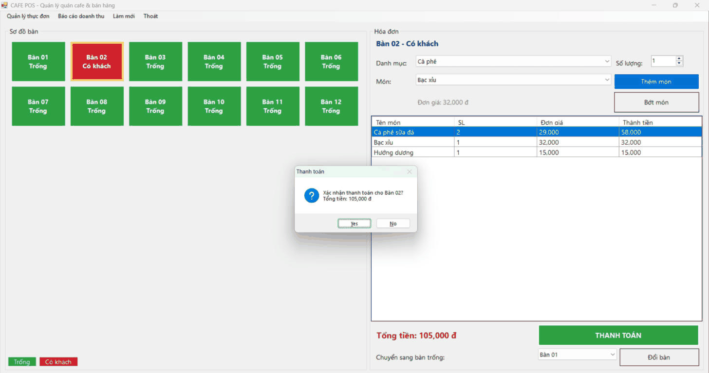
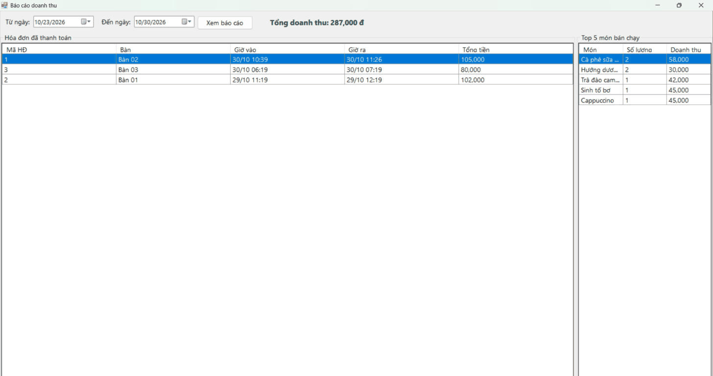
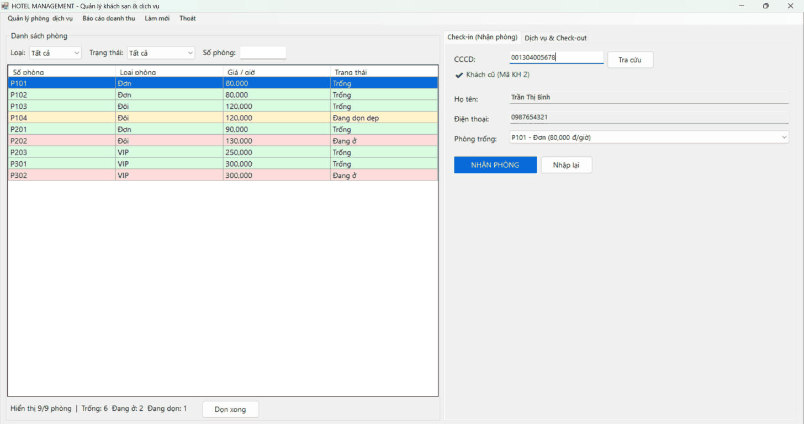
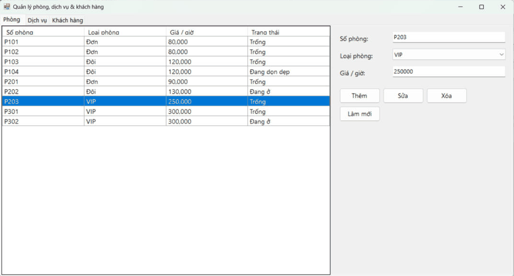
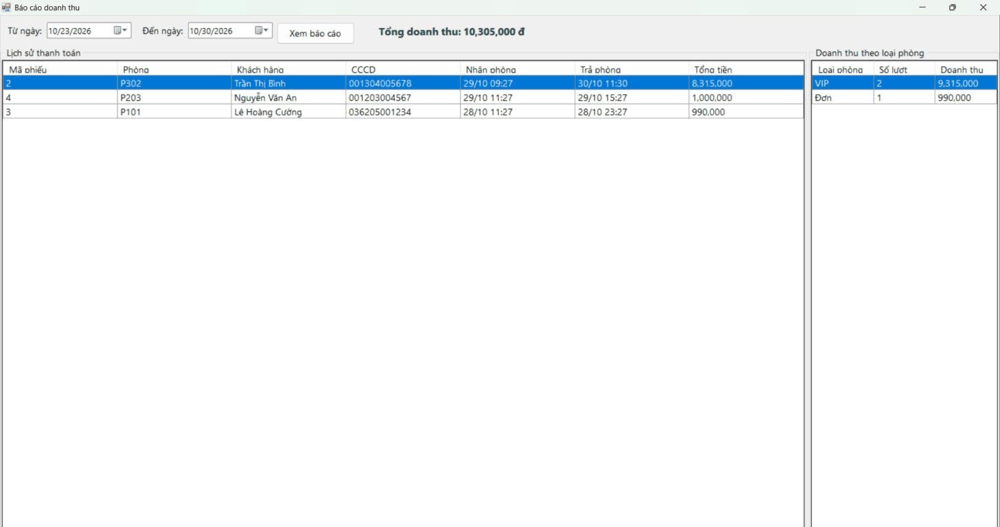

# BÀI TẬP 5.3 – 5.4 – 5.5: ỨNG DỤNG WINFORMS C# + ADO.NET + SQL SERVER

Tập hợp 3 bài tập, mỗi bài là một ứng dụng WinForms (C#, .NET Framework 4.8) kết nối SQL Server bằng ADO.NET, kiến trúc 3 lớp **DTO – DAL – BUS – GUI**.

| Bài | Thư mục | Tên đề tài |
|---|---|---|
| 5.3 | [`5.3/`](5.3) | Hệ thống quản lý quán Cafe & bán hàng (POS Cafe System) |
| 5.4 | [`5.4/`](5.4) | Hệ thống quản lý tiện ích dịch vụ & khách sạn (Hotel Management System) |
| 5.5 | [`5.5/`](5.5) | Hệ thống quản lý quy trình xuất - nhập kho nguyên vật liệu (Inventory Management) |

## MỤC 1: THÔNG TIN SINH VIÊN

- **Họ và tên sinh viên:** Trần Thế Hào
- **Mã sinh viên:** 24810320120
- **Lớp:** D19QTANM1
- **Tên Đề tài / Bài tập:** Bài 5.3, 5.4, 5.5 – Xem chi tiết từng bài ở bên dưới

## MỤC 2: HƯỚNG DẪN CÀI ĐẶT & CHẠY DỰ ÁN (CHUNG CHO CẢ 3 BÀI)

**Yêu cầu:** Visual Studio 2022 (workload *.NET desktop development*, đã kèm SQL Server Express LocalDB).

1. Mở file `.sln` của bài tương ứng bằng Visual Studio 2022:
   - Bài 5.3: `5.3/CafePOS.sln`
   - Bài 5.4: `5.4/HotelManagement.sln`
   - Bài 5.5: `5.5/InventoryManagement.sln`
2. Build & Run dự án (F5). Ở lần chạy đầu, chương trình tự kiểm tra: nếu chưa có CSDL tương ứng thì tự chạy file `Database/ScriptDB.sql` của bài đó để tạo bảng và dữ liệu mẫu (lớp `DAL/DbInit.cs`).
3. Mặc định chuỗi kết nối dùng `(localdb)\MSSQLLocalDB`. Nếu muốn dùng SQL Server khác, sửa `Data Source` trong file `App.config` của dự án (ví dụ `.\SQLEXPRESS`).
4. Có thể chạy thủ công `Database/ScriptDB.sql` bằng SQL Server Management Studio (SSMS) nếu muốn tạo lại CSDL từ đầu.

| Bài | CSDL | File `App.config` |
|---|---|---|
| 5.3 | `CafePOSDB` | `5.3/CafePOS/App.config` |
| 5.4 | `HotelDB` | `5.4/HotelManagement/App.config` |
| 5.5 | `InventoryDB` | `5.5/InventoryManagement/App.config` |

## Cấu trúc thư mục tổng

```
├── 5.3/                          # Bài 5.3 – CafePOS
│   ├── Database/
│   ├── CafePOS/
│   ├── images/
│   └── CafePOS.sln
├── 5.4/                          # Bài 5.4 – HotelManagement
│   ├── Database/
│   ├── HotelManagement/
│   ├── images/
│   └── HotelManagement.sln
├── 5.5/                          # Bài 5.5 – InventoryManagement
│   ├── Database/
│   ├── InventoryManagement/
│   ├── images/
│   └── InventoryManagement.sln
└── README.md
```

---

# BÀI 5.3 – HỆ THỐNG QUẢN LÝ QUÁN CAFE & BÁN HÀNG (POS CAFE SYSTEM)

Thư mục: `5.3/` – Solution: `5.3/CafePOS.sln`

## Cấu trúc thư mục

```
5.3/
├── Database/
│   └── ScriptDB.sql            # Tạo CSDL CafePOSDB (5 bảng) + dữ liệu mẫu
├── CafePOS/
│   ├── DTO/                    # BanAnDTO, DanhMucDTO, MonAnDTO, HoaDonDTO
│   ├── DAL/                    # DatabaseHelper, BanAnDAL, DanhMucDAL, MonAnDAL, HoaDonDAL
│   ├── BUS/                    # BanAnBUS, DanhMucBUS, MonAnBUS, HoaDonBUS (validation nghiệp vụ)
│   ├── GUI/                    # FrmMain, FrmQuanLyThucDon, FrmBaoCao
│   ├── App.config              # Chuỗi kết nối
│   └── Program.cs
├── images/                     # Ảnh chụp màn hình kết quả
└── CafePOS.sln
```

## Chức năng đã thực hiện

| Yêu cầu đề bài | Cách thực hiện |
|---|---|
| Mô hình ngắt kết nối nạp menu | `MonAnDAL.LoadMenuDataSet()` dùng **SqlDataAdapter** đổ 2 bảng DanhMuc, MonAn vào một **DataSet** (có DataRelation); khi đổi danh mục chỉ lọc bằng **DataView.RowFilter**, không truy vấn lại CSDL |
| Sơ đồ bàn | Danh sách **Button tạo động** theo bảng BanAn; bàn *Trống* màu xanh, *Có khách* màu đỏ, bàn đang chọn có viền vàng |
| Gọi món | Chọn bàn → nạp các món đã gọi vào **DataGridView** bằng SqlDataAdapter + DataTable; chọn danh mục, món, số lượng → *Thêm món*; bàn tự chuyển sang *Có khách*. Có thêm chức năng *Bớt món* |
| Đổi bàn | Chuyển hóa đơn đang mở sang bàn trống khác (trong SqlTransaction) |
| Thanh toán | `HoaDonDAL.ThanhToan()`: tính tổng tiền → cập nhật GioRa, TongTien, TrangThai = 1 → trả bàn về *Trống*; **tất cả nằm trong một SqlTransaction**, lỗi thì Rollback |
| Quản lý thực đơn (3-Tier CRUD) | `FrmQuanLyThucDon`: Thêm / Sửa / Xóa / Tìm kiếm món và danh mục. Lớp BUS chặn **tên món để trống** và **đơn giá âm** |
| Báo cáo | `FrmBaoCao`: hóa đơn đã thanh toán theo khoảng ngày, Top 5 món bán chạy, tổng doanh thu tính bằng **ExecuteScalar** |
| Chống SQL Injection | Mọi câu lệnh đều dùng **SqlParameter** |

## HÌNH ẢNH KẾT QUẢ CÁC MÀN HÌNH CHỨC NĂNG – BÀI 5.3

1. Màn hình Chính / Tổng quan (sơ đồ bàn):
   
2. Màn hình Quản lý Danh mục / Thêm Sửa Xóa (CRUD):
   
3. Màn hình Thực thi Nghiệp vụ chính (Gọi món / Thanh toán):
   
4. Màn hình Báo cáo - Thống kê:
   
5. Minh họa xử lý lỗi (nhập đơn giá âm / tên món trống bị chặn):
   

---

# BÀI 5.4 – HỆ THỐNG QUẢN LÝ TIỆN ÍCH DỊCH VỤ & KHÁCH SẠN (HOTEL MANAGEMENT SYSTEM)

Thư mục: `5.4/` – Solution: `5.4/HotelManagement.sln`

## Cấu trúc thư mục

```
5.4/
├── Database/
│   └── ScriptDB.sql              # Tạo CSDL HotelDB (5 bảng) + dữ liệu mẫu
├── HotelManagement/
│   ├── DTO/                      # PhongDTO, KhachHangDTO, DichVuDTO (ServiceDTO), PhieuDatPhongDTO,
│   │                             # SuDungDichVuDTO, HoaDonThanhToanDTO
│   ├── DAL/                      # DatabaseHelper, PhongDAL, KhachHangDAL, DichVuDAL, PhieuDatPhongDAL
│   ├── BUS/                      # PhongBUS, KhachHangBUS, DichVuBUS, DatPhongBUS
│   ├── GUI/                      # FrmMain, FrmQuanLy, FrmBaoCao, UiHelper
│   ├── App.config
│   └── Program.cs
├── images/
└── HotelManagement.sln
```

## Chức năng đã thực hiện

| Yêu cầu đề bài | Cách thực hiện |
|---|---|
| Check-in | Tra cứu khách theo **CCCD bằng SqlParameter**. Khách mới thì nhập họ tên, SĐT. Chọn phòng trống → `PhieuDatPhongDAL.CheckIn()` trong **một SqlTransaction**: thêm khách (nếu mới) → lập phiếu → phòng sang *Đang ở* (có khóa `UPDLOCK` để 2 người không nhận trùng phòng) |
| Gọi dịch vụ | Chọn phòng *Đang ở* → chọn dịch vụ + số lượng; dữ liệu đi qua **SuDungDichVuDTO / DichVuDTO** từ GUI → BUS → DAL |
| Check-out & hóa đơn | Tổng tiền = **(số giờ ở × giá theo giờ) + tổng tiền dịch vụ**, số giờ làm tròn lên (tối thiểu 1 giờ). Xác nhận → `CheckOut()` trong **SqlTransaction**: lưu TongTienThanhToan, NgayTraPhong → phòng sang *Đang dọn dẹp*. Nút *Dọn xong* trả phòng về *Trống* |
| Lọc & tìm phòng ngắt kết nối | Danh sách phòng nạp 1 lần vào **DataTable**, lọc theo Loại phòng / Trạng thái / Số phòng bằng **DataView.RowFilter** ngay trên giao diện, không truy vấn lại CSDL. Các dòng tô màu theo trạng thái |
| CRUD | `FrmQuanLy`: Thêm / Sửa / Xóa phòng và dịch vụ, xem danh sách khách hàng; BUS kiểm tra dữ liệu (giá > 0, tên không trống, CCCD 12 số…) |
| Báo cáo | `FrmBaoCao`: lịch sử thanh toán theo ngày, doanh thu theo loại phòng, tổng doanh thu tính bằng **ExecuteScalar** |
| Chống SQL Injection | Mọi truy vấn đều dùng **SqlParameter** |

## HÌNH ẢNH KẾT QUẢ CÁC MÀN HÌNH CHỨC NĂNG – BÀI 5.4

1. Màn hình Chính / Tổng quan (danh sách phòng + lọc):
   
2. Màn hình Quản lý Danh mục / Thêm Sửa Xóa (CRUD):
   
3. Màn hình Thực thi Nghiệp vụ chính (Check-in / Gọi dịch vụ / Check-out):
   
4. Màn hình Báo cáo - Thống kê:
   
5. Minh họa xử lý lỗi (CCCD sai định dạng / nhận phòng không còn trống):
   

---

# BÀI 5.5 – HỆ THỐNG QUẢN LÝ QUY TRÌNH XUẤT - NHẬP KHO NGUYÊN VẬT LIỆU (INVENTORY MANAGEMENT)

Thư mục: `5.5/` – Solution: `5.5/InventoryManagement.sln`

## Cấu trúc thư mục

```
5.5/
├── Database/
│   └── ScriptDB.sql              # Tạo CSDL InventoryDB + dữ liệu mẫu (tồn kho khớp với các phiếu mẫu)
├── InventoryManagement/
│   ├── DTO/                      # NhaCungCapDTO, VatTuDTO, PhieuKhoDTO, ChiTietPhieuKhoDTO
│   ├── DAL/                      # DatabaseHelper, NhaCungCapDAL, VatTuDAL, PhieuKhoDAL
│   ├── BUS/                      # NhaCungCapBUS, VatTuBUS, PhieuKhoBUS
│   ├── GUI/                      # FrmMain, UcPhieuKho, UcVatTu, UcNhaCungCap, UcBaoCao, UiHelper
│   ├── App.config
│   └── Program.cs
├── images/
└── InventoryManagement.sln
```

> Bảng `VatTu` có thêm cột `DinhMucToiThieu` (ngưỡng tồn kho an toàn) để phục vụ chức năng cảnh báo tồn kho.

## Chức năng đã thực hiện

| Yêu cầu đề bài | Cách thực hiện |
|---|---|
| Quản lý Vật tư & Nhà cung cấp (Connected Model) | Thêm / Sửa / Xóa / Tra cứu qua lớp BUS → DAL, dùng `SqlConnection` + `SqlCommand` + `SqlDataReader`. Không cho xóa vật tư / NCC đã phát sinh phiếu |
| Tìm kiếm chống SQL Injection | Tìm vật tư theo **mã hoặc tên** bằng `SqlParameter` (nhập `' OR 1=1 --` chỉ được coi là chuỗi tìm kiếm). Mọi câu lệnh khác cũng dùng SqlParameter |
| Lập phiếu Nhập / Xuất (SqlTransaction) | Chọn loại phiếu → thêm danh sách vật tư, số lượng, đơn giá → **Lưu phiếu kho**: `PhieuKhoDAL.LuuPhieuKho()` mở một `SqlTransaction` và lần lượt: (1) chèn `PhieuKho`, (2) chèn `ChiTietPhieuKho`, (3) **NHAP** cộng `SoLuongTon`; **XUAT** kiểm tra tồn, nếu `SoLuongTon < SoLuong` thì gọi `trans.Rollback()` và báo **"Không đủ hàng trong kho"**, (4) `trans.Commit()` khi tất cả thành công |
| Cảnh báo tồn kho | Danh sách vật tư có `SoLuongTon < DinhMucToiThieu`, kèm số lượng cần nhập thêm. Ở tab Vật tư, các dòng này hiện chữ đỏ |
| Tổng giá trị tồn kho | Tính bằng **`ExecuteScalar`**: Σ (SoLuongTon × đơn giá nhập gần nhất) |
| Báo cáo | Lịch sử phiếu kho theo ngày / loại phiếu và chi tiết từng phiếu |

## HÌNH ẢNH KẾT QUẢ CÁC MÀN HÌNH CHỨC NĂNG – BÀI 5.5

1. Màn hình Chính / Tổng quan:
   
2. Màn hình Quản lý Danh mục / Thêm Sửa Xóa (CRUD):
   
3. Màn hình Thực thi Nghiệp vụ chính (Lập phiếu nhập / xuất):
   
4. Màn hình Báo cáo - Thống kê (cảnh báo tồn kho, tổng giá trị tồn):
   
5. Minh họa báo lỗi giao dịch – xuất quá số tồn, phiếu bị Rollback:
   
